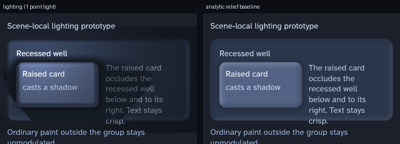
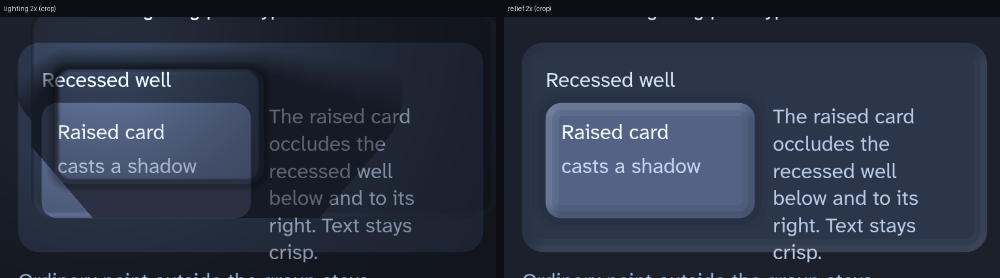
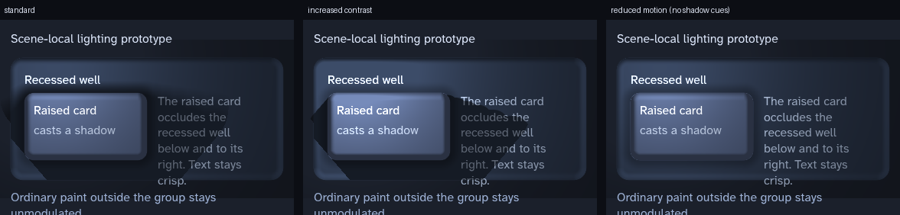

# Issue #105: scene-local lighting prototype — Windows/D3D12 (2026-11-22)

**Verdict: NO-GO for shipping in v0.3.0.** The prototype is deterministic, opt-in,
bounded, and measurably affordable on the tested GPU, and it does express a true
cross-surface shadow that the per-surface analytic relief cannot. It does **not**
demonstrate the issue's full GO gate: the visual comparison is at best
comparable rather than clearly better at 1x, and the mandatory older/integrated
GPU-class evidence is missing. The issue explicitly allows concluding that the
existing static relief is better; keep the static relief as the shipped
treatment and keep this branch as the research artifact.

## Environment

| | |
| --- | --- |
| GPU | NVIDIA GeForce RTX 2080 SUPER (consumer high-end, 8 GB) |
| Driver | 32.0.15.9597 |
| OS | Windows 10 Home 10.0.19045 |
| Backend | SDL_GPU Direct3D12 (`--driver=direct3d12`), SDL 3.4.2 |
| Toolchain | Odin `dev-2026-11-nightly:08539cd` |
| D3D12 shader | DXC 1.9.2609 (pinned), SPIR-V glslang 16.6.0 (pinned) |

The machine also exposes an AMD Radeon integrated adapter, but SDL_GPU device
creation selects the default (NVIDIA) adapter and this prototype has no adapter
selector. **Integrated-GPU class remains unverified.** No CI lavapipe result was
produced for this branch either; the earlier WebGPU feasibility record's
lavapipe tier is reference-only and does not cover this D3D12 shader.

## What was built

- Runtime: per-frame `lighting_group` declaration, validated light/ambient
  bounds, accessibility flag resolution, and a single ordered
  `Lighting_Group_Paint` marker inserted by `lighting_publish` at the end of
  every paint stage. The marker is emitted only for a declared group with at
  least one non-flat surface; a frame with an existing backdrop boundary keeps
  ordinary paint. See [the design record](../research/issue-105-lighting.md).
- Native: the lighting plan and composite ride the existing retained-effects
  slots, byte budget, and fence retirement. One cropped RGBA8 capture, no
  filter passes, and one fragment program that evaluates every rounded-slab SDF
  and point light per pixel, with source-radius penumbra, contact occlusion, and
  bevel normals from the SDF gradient.
- Fixture: a recessed well containing a raised card (both `material_group=7`),
  with in-surface text, one movable point light, and a movable-light cost
  matrix. The relief baseline describes the identical tree with the shipped
  `Analytic_Relief` material instead of a lighting declaration.

## Visual comparison

Artifacts (PPM captures are written to `out/lighting/`; PNGs below are the
committed comparison):





At 1x the lighting version shows a coherent bevel gradient on the card, contact
darkening where the card meets the well, and a soft cast shadow to the
lower-right of the card; the text inside both surfaces keeps its hue and stays
legible. The relief baseline shows a tighter, darker drop shadow and crisper
bevel bands. At 2x the lighting cast shadow is clearly the more coherent
scene-level cue (its direction agrees with the light), while the relief bevels
remain sharper.

Quantitatively, 73,646 of 98,304 pixels (74.9%) differ from the relief capture,
with a worst channel delta of 115/255; at 2x, 309,812 pixels differ. That is a
large visual delta, but it is a re-shading of the whole group, not evidence of
greater clarity.

Judgement: **not demonstrably clearer than the existing relief** on this probe.
The prototype wins on scene coherence (real occlusion) and loses on edge
sharpness and immediacy at UI scale. A real dogfood scene (Scratchpad) was not
re-authored for this experiment, and the issue's gate explicitly asks for a real
dogfood scene.

## Determinism

- Two consecutive captures of the same retained display list, each through an
  independently created effects cache, are **byte-identical**. A third capture
  is also byte-identical.
- Across two separate process runs the standard capture hash is identical:
  `1068762192490076064`; the relief capture hash is
  `17599191152166607343`.
- The first composite in a fresh process differs from later ones by at most one
  LSB on 68/98,304 pixels (0.07%) confined to the capture region's edge; a
  one-frame warm-up removes it. The measured contract therefore starts after
  pipeline/atlas warm-up, matching steady-state hosting.
- Moving a light changes the marker generation and re-captures; identical inputs
  reproduce the cached generation (the matrix's "rest" row reuses the capture:
  `rest_capture_reused=true`, `rest_composites=1`).

## Accessibility



| Variant | Changed pixels vs standard | Behaviour |
| --- | --- | --- |
| increased contrast | 59,959 | hard shadows, stronger bevel response |
| reduced motion | 18,589 | shadow cues removed (contact occlusion remains) |

Both variants keep captured text legible; the shader's luminance modulation is
bounded to `[0.5, 1.4]` and never changes hue. The flags are part of the marker
generation, so switching a preference invalidates the cached composite.

## Cost

`submit_wait` is a fence round trip for the whole frame (it includes the
ordinary paint plus the effect passes), not a GPU timestamp query. `p50` is the
stable comparison; `p95` on this host shows sporadic scheduler/fence-wait
spikes (observed 0.39–0.74 ms for lighting at 1x while p50 stayed at
0.12–0.13 ms), so it is reported but not used to rank modes.

Probe region: 404×208 logical at 1x (808×416 at 2x), one group with two
surfaces. 40 samples after 4 warm-up frames, light moved every frame.

| Mode | encode p50 | submit-wait p50 | effect passes/frame | live/peak bytes | allocations |
| --- | ---: | ---: | ---: | ---: | ---: |
| relief 1x (baseline) | 47–49 us | 92–93 us | 0 | 0 | 0 |
| relief 2x (baseline) | 47–48 us | 99 us | 0 | 0 | 0 |
| lighting, 1 light, 1x | 82–85 us | 119–125 us | 3 | 420,368 | 5 |
| lighting, 4 lights, 1x | 83–85 us | 128–131 us | 3 | 420,368 | 5 |
| lighting, 1 light, 2x | 83–105 us | 143–162 us | 3 | 1,428,752 | 5 |
| lighting, 4 lights, 2x | 83–86 us | 159–176 us | 3 | 1,428,752 | 5 |
| lighting, 1 light, 2x, no shadows | 83–86 us | 135–144 us | 3 | 1,428,752 | 5 |
| lighting, 4 lights, 2x, no shadows | 83–86 us | 141–143 us | 3 | 1,428,752 | 5 |

Cached rest frame (unchanged generation and content): capture/encode skipped,
one composite only. Rest `submit_wait` p50: 97.5–102.7 us (1 light 1x),
108.6–140.6 us (2x); `rest_encode_ns` 34.8–38.4 us versus 82–105 us live.

Reading:

- Live cost over the relief baseline is roughly **+26…+37 us at 1x** and
  **+45…+77 us at 2x** for one to four lights. Shadow marching accounts for the
  larger part of the 4-light 2x delta (no-shadow 2x is ~141 us p50 versus
  ~159–176 us with shadows).
- Memory is **420 KiB at 1x / 1.43 MiB at 2x**, about a quarter of a same-size
  Gaussian blur's source+ping+output charge (the shared 42 KiB vertex/transfer
  pair included in both).
- "Zero submissions at rest" is a host-loop property: after the host
  acknowledges the last revision, `frame_needs_submission` is false and an
  unchanged description is not rebuilt (`lighting_idle PASS`). A static lit
  scene therefore submits no frames at all; a frame that does run (e.g. hover or
  light animation) always pays the composite.

## Zero cost when unused

- No declaration and no carried marker: `lighting_publish` is one boolean test;
  `lighting_emits` stays 0 and no marker exists.
- Declaration with no qualifying non-flat surface: no marker; a fresh effects
  cache drawn over the scene keeps `allocations=0`, `lighting_prepares=0`,
  `lighting_composites=0`, `filter_passes=0`, `live_bytes=0`.
- `Paint_Command` remains 128 bytes: the 16-byte marker payload fits the existing
  payload union with no growth.

## Suites run

| Suite | Result |
| --- | --- |
| `odin test runtime` | pass, including 4 new lighting tests |
| `odin test renderer/cpu` | pass, including 2 new plan/uniform/mesh tests |
| `odin test native/sdl_gpu` | pass (172 tests) |
| `tools/validate_effects.ps1` (D3D12) | pass: Gaussian 9/9, geometry payload revision, unchanged-cache, budget fallback, lighting validation/idle/cost |
| `odin test testui` | pass |
| `odin test ui` | pass |
| `odin test theme` | pass (no theme package in this branch; `ui`/`runtime` cover the token helpers) |
| example 16 build | unchanged; no lighting declaration in the example |

Some intermediate runs showed the harness's unrelated `WinPixEventRuntime.dll`
loader notice on shutdown; it does not appear in the committed raw log and did
not change the lighting results.

## Gate analysis

| Gate clause | Evidence | Outcome |
| --- | --- | --- |
| Perceptually clearer than existing relief | probe comparison; real dogfood scene not authored | **not met** (comparable; relief sharper at 1x) |
| Acceptable cost on ordinary desktop GPUs | 0.12–0.18 ms p50 submit-wait at 1x/2x on a 2018 high-end GPU; +26…+77 us over relief | met on this GPU |
| Older/integrated GPU class tested | absent; SDL_GPU picks the discrete adapter | **not met** |
| Deterministic replay | byte-identical settled captures and cross-process hash | met |
| Opt-in / no cost when unused / zero submissions at rest | counters and idle check | met |
| Accessibility reduced/contrast behaviour | variant captures and flag tests | met |

Per the issue, a NO-GO is a valid outcome. Recommended next steps if this is
revisited: author a real Scratchpad scene where cross-surface occlusion matters,
add adapter selection (or a CI lavapipe/D3D12 WARP run) to obtain integrated-tier
numbers, and consider replacing the per-pixel ray march with an amortized
height/SDF prepass only if the visual gate is otherwise met.

## Reproduction

```powershell
.\tools\build_lighting_shaders.ps1
.\tools\validate_effects.ps1 -Driver direct3d12
```

Raw console output: [raw/issue-105-lighting-2026-11-22.txt](raw/issue-105-lighting-2026-11-22.txt).
