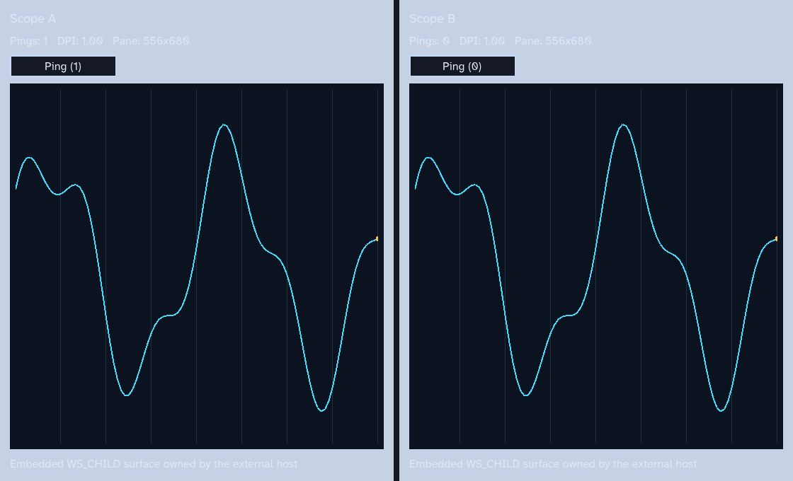

# Issue #121 Phase B — embedded plugin editor PoC (Windows)

Date: 2026-11-22

Issue: [#121 Prototype embeddable Alicorn editor surfaces for native plugin hosts](https://github.com/Carnival-Science/Alicorn/issues/121)

Scope: the narrow Phase B proof of concept, not a CLAP/VST3 wrapper, DAW audio
processing, signing/distribution, or a change to the default SDL host.

## Verdict

**GO** for the Phase B gate on Windows.

The external minimal host fixture is a plain Win32 parent window with no
SDL window, event loop, or surface ownership. It creates, attaches, shows,
hides, resizes, reopens, and destroys Alicorn-powered scope editors as
`WS_CHILD` HWNDs; runs two simultaneous instances; isolates input per child;
simulates device loss and rebuilds the GPU path while retaining Runtime state;
and tears down cleanly. All 18 fixture checks pass on both D3D12 and Vulkan on
the real RTX 2080 SUPER. Expansion to CLAP/VST3 backends remains future work.

This is a **conditional** platform verdict, not a claim of production parity:

- Windows embedded surfaces are real-hardware validated.
- macOS and Linux compile-check the typed refusal path only; they still need
  their own NSView/X11 child-surface implementations.
- Wayland is explicitly unsupported and documents the floating-editor
  fallback.
- Inline IME composition and assistive-technology (Narrator/UIA) validation are
  not closed by this slice.

## Environment

| Item | Value |
| --- | --- |
| OS | Windows 10 22H2 |
| GPU | NVIDIA RTX 2080 SUPER |
| Compiler | `C:\odin\odin.exe` |
| WebGPU | wgpu-native 29.0.1.1, D3D12 and Vulkan adapters |
| SDL | not linked by the fixture; pinned project SDL is 3.4.20 |

## SDL parent decision

Pinned SDL 3.4.20 exposes `SDL_PROP_WINDOW_CREATE_PARENT_POINTER`, but its value
is an `SDL_Window *`, not a foreign `HWND`. It also exposes
`SDL_PROP_WINDOW_CREATE_WIN32_HWND_POINTER` for wrapping an existing HWND when
SDL owns that window's event life. Wrapping the plugin host's parent in SDL
would transfer ownership of the host window and event behavior, which defeats
the embedding boundary.

The Windows adapter therefore creates its own `WS_CHILD` HWND and calls
`wgpu.InstanceCreateSurface` with `wgpu.SurfaceSourceWindowsHWND` directly. The
fixture imports no SDL package and proves the child-window/surface/input path is
independent of SDL.

## Fixture design

Executable: `out/plugin_host_fixture.exe`
Source: `tests/fixtures/plugin_host/main.odin`
Runner: `tools/validate_plugin_host.ps1`

The fixture registers a plain Win32 parent class and creates one top-level
window. Its message loop dispatches child-window messages normally. Each editor
gets:

- one `WS_CHILD | WS_CLIPSIBLINGS | WS_CLIPCHILDREN` HWND created by
  `alicorn:host/plugin`;
- one WebGPU surface created directly from that HWND;
- one `Hosted_Runtime` with its own retained description, motion deadline,
  scheduler, focus/capture state, and wake target;
- one `Hosted_Surface_Presenter` sharing the host's instance/adapter/device/
  queue;
- a small scene: heading, status, a Ping button, and a custom GPU-surface
  waveform panel updated from `on_after_frame`.

The self-test drives: first attach/present, settled idle, resize, hide/show,
1.5x DPI resize, scoped keyboard activation, second simultaneous instance,
input isolation, close A while B keeps running, two sequential reopens, device
loss recovery, post-recovery idle, and teardown.

## Acceptance matrix

| Acceptance item | Evidence | Result |
| --- | --- | --- |
| External minimal host attaches an Alicorn-powered scope | Plain Win32 parent + child HWND + wgpu surface; first frame presented | PASS |
| Removes the scope | `plugin_host_destroy_editor`; `close-a-succeeds` | PASS |
| Repeated open/close | Two sequential create/present/destroy rounds; host editor count returns to 1 | PASS |
| Two simultaneous instances | A and B each present; independent presenter/config counters | PASS |
| Resize | `plugin_editor_resize` 520x360; drawable adopted; new frame | PASS |
| DPI | 640x400 logical at 1.5 -> 960x600 drawable; dpi=1.50 reported | PASS |
| Hide/show | Hidden: zero presentations over 500 ms; show: frame presented | PASS |
| Scoped input | Tab+Space to child A increments A only; same to B increments B only | PASS |
| Device-loss simulation | Inject loss, rebuild instance/surfaces/device/presenters, present again | PASS |
| Retained state survives loss | B's click count unchanged across recovery | PASS |
| Settled idle | Zero presentations over 750 ms after settle | PASS |
| Post-recovery idle | Zero presentations over 500 ms | PASS |
| Teardown | All editors/host destroyed; no timeout | PASS |

### D3D12 run

```text
[plugin-fixture] PASS editor-a-created-and-presented
[plugin-fixture] PASS settled-idle-zero-presentations frames=0 steps=3
[plugin-fixture] PASS resize-adopts-drawable pixel=520x360 presentations=2
[plugin-fixture] PASS hidden-editor-zero-presentations frames=0
[plugin-fixture] PASS show-restores-presentation
[plugin-fixture] PASS dpi-resize-adopts-scale logical=640x400 pixel=960x600 dpi=1.50
[plugin-fixture] PASS scoped-keyboard-activates-editor-a clicks=0->1
[plugin-fixture] PASS two-independent-editors-coexist
[plugin-fixture] PASS input-isolation-between-instances a=1->1 b=0->1
[plugin-fixture] PASS close-a-succeeds
[plugin-fixture] PASS b-survives-a-close frames=2
[plugin-fixture] PASS repeated-open-close
[plugin-fixture] PASS device-loss-injection
[plugin-fixture] PASS device-loss-recovery-presents frames=2
[plugin-fixture] PASS device-loss-preserves-retained-state clicks=1
[plugin-fixture] PASS post-recovery-settled-idle frames=0
[plugin-fixture] PASS teardown-clean
[plugin-fixture] self-test end passed=18 failed=0
```

### Vulkan run

The same 18 checks passed with `--backend=vulkan` on the same machine
(`self-test end passed=18 failed=0`).

## Resource and timing metrics

These are process-private-byte deltas sampled around editor creation and the
first frame. The first editor's delta includes process-wide wgpu instance,
adapter, device, queue, shader/pipeline caches, and allocator slack; it is not
an isolated per-editor heap measurement. Incremental second-editor and reopen
deltas are the more useful per-editor upper bound. GPU byte accounting is not
available from wgpu-native in this slice.

| Measurement | D3D12 | Vulkan |
| --- | --- | --- |
| First editor delta | 565,846,016 B | 560,959,488 B |
| Second simultaneous editor delta | 191,373,312 B | 211,181,568 B |
| Reopen round 1 delta | 187,719,680 B | 189,820,928 B |
| Reopen round 2 delta | 186,396,672 B | 186,925,056 B |
| Total host steps in self-test | 63 (includes 3 s screenshot hold) | 52 |
| Total presented frames | 28 | 28 |
| Last surface configure | 1.29 ms | 31.4 ms (recovery configure) |

GPU resources: one shared instance/adapter/device/queue for the host; per
editor one HWND, one surface, one swapchain, one presenter, and its retained
renderer caches. Each editor configures its own surface (initial `configure=2`
after create/resize in the fixture; `configure=1` after recovery). Closing an
editor releases only its surface/presenter/runtime; the device and the other
editor remain alive.

Presenter CPU step-to-successful-submit latency (not GPU execution or scanout):

| Phase | D3D12 p50 / p95 / max | Vulkan p50 / p95 / max |
| --- | --- | --- |
| A, first editor (13 samples) | 0.83 / 2.06 / 20.23 ms | 0.38 / 1.75 / 27.07 ms |
| B, second editor (4 samples) | 0.44 / 1.02 / 2.18 ms | 0.18 / 0.50 / 1.95 ms |
| B, post-recovery (2 samples) | 0.99 / 0.99 / 1.96 ms | 0.19 / 0.19 / 1.34 ms |

The long first samples include font seeding, renderer/shader setup, and the
first swapchain acquisition. They are not steady-state frame costs.

## Screenshot



Captured from the external parent's client area with the D3D12 run. Scope A has
one Ping; Scope B is independent. The window caption/titlebar belongs to the
external Win32 host, not Alicorn.

## Platform matrix

| Platform | Surface contract | Status |
| --- | --- | --- |
| Windows 10/11 | `WS_CHILD` HWND + `SurfaceSourceWindowsHWND` | Implemented; real D3D12 + Vulkan fixture |
| macOS | `Cocoa_NSView` | Typed `Unsupported_Platform`; compile-checked; floating fallback |
| Linux X11 | `X11_Window` | Typed `Unsupported_Platform`; compile-checked; floating fallback |
| Linux Wayland | `Wayland_Surface` | Typed `Unsupported_Wayland`; compile-checked; documented floating fallback |

`plugin_capabilities()` reports the contract; `plugin_status_string()` names
the fallback. No unsupported platform creates a hidden top-level window.

## Accessibility

`host/plugin/accessibility` provides an optional per-editor AccessKit adapter
using the existing SDL3 per-window projection host. A new
`native_accessibility_adapter_init_hwnd` seam allows the adapter to attach to
the plugin's own child HWND. The unit test (`host/plugin/accessibility`) creates
a hidden external HWND, attaches AccessKit, builds a Runtime with a button,
syncs semantics, runs focus changes, and destroys the adapter: 1/1 pass.

Limits: the plugin wake path is Win32, so the accessibility waker is inactive in
this slice; activation still returns a fresh tree. Narrator/NVDA tree
navigation, UIA action delivery, and focus behavior against the real fixture
were not exercised. Native semantics are therefore optional and compile/test
proven, not assistive-technology validated.

## Input and IME

Scoped translation covers mouse, wheel, capture loss, focus, Tab traversal,
Enter/Space activation, application keys, text navigation/editing intents, and
committed `WM_CHAR`/`WM_IME_CHAR` text. Each child owns its input stream.

Inline IME composition is not implemented in Phase B:
`plugin_capabilities().ime_composition` is false. Committed characters work,
but preedit, candidate placement, and `Imm32` composition-window synchronization
remain open. This is a NO-GO for claiming IME parity with the SDL host.

## Device loss and shutdown

The fixture's `plugin_host_simulate_device_loss` follows the
`--test-simulate-unexpected-device-loss` pattern from `host/sdl3/run.odin`:
presenters are marked lost, completion callbacks are drained, surfaces and the
shared device are released, then the instance/surfaces/adapter/device are
rebuilt and presenters reattached to the same retained runtimes. Recovery is
bounded (5 s per phase) and runs on the UI thread because a plugin host has no
secondary UI thread.

This validates the recovery state machine, not real driver/hardware removal.
Teardown stops new submissions, drains pending presenter work, destroys the
Runtime (including `on_stop` worker joins), then destroys the child HWND.

## Suites

Targeted suites run for this slice:

```text
odin test runtime                         511 tests, all successful
odin test host\sdl3                        8 tests, all successful
odin test host\diagnostics                 9 tests, all successful
odin test testui                          37 tests, all successful
odin test ui                              57 tests, all successful
odin test host\plugin                      7 tests, all successful
odin test host\plugin\accessibility        1 test, successful
tests/fixtures/plugin_host --self-test    18/18 checks, D3D12 and Vulkan
```

The repository's `tools/test.ps1` AccessKit preflight is subject to the
documented Windows PowerShell 5.1 native-stderr harness caveat; the pinned
AccessKit tests themselves pass (8/8) and the plugin accessibility test passes
1/1 when invoked with the bootstrap compiler arguments. The suites above were
run individually with `C:\odin\odin.exe`; the AccessKit-owned 8/8 run and the
new fixture are the only additional pieces the preflight would add.

## Open items before a CLAP/VST3 backend

1. macOS NSView and Linux X11/XEmbed child-surface adapters; keep Wayland as a
   floating fallback until a validated surface role exists.
2. Real IME composition/preedit at the child HWND and its candidate window.
3. Narrator/NVDA UIA validation for the per-editor AccessKit adapter.
4. Real driver-loss and application-forced device-reset evidence.
5. GPU-byte and per-editor allocation accounting beyond process-private deltas.
6. A CLAP/VST3 `IPlugView`/GUI-extension binding that maps the create/attach/
   show/hide/resize/destroy calls to this adapter.
